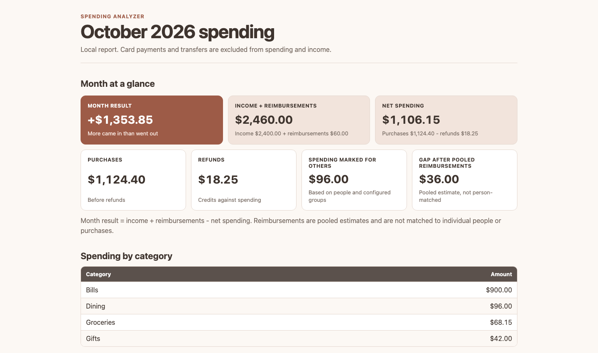

# Local Spending Analyzer

Bank exports can show where money moved, but they cannot explain whether a purchase was mine, something I bought for someone else, a gift, or money I expected to get back. I built Local Spending Analyzer to turn those exports into a monthly view that answers those questions without uploading financial data anywhere.

The tool imports supported bank CSVs, asks about transactions it has not seen before, remembers reusable choices, and produces an Excel workbook plus a phone-friendly HTML report. Everything runs locally. There are no bank logins, cloud APIs, analytics, or AI services.

> **Status:** Working and in development. The current version targets macOS and the tested US consumer CSV layouts listed below.



The screenshot is real output generated by this repository using fictional transactions.

## What it does

- Imports multiple card and checking exports into one normalized history.
- Merges overlapping exports and skips exact duplicate files without losing the originals.
- Asks for a category only when a saved decision or account-specific rule does not apply.
- Tracks who spending was for, named group categories, split purchases, refunds, income, and estimated reimbursements.
- Writes completed answers as you go, so an interrupted review can continue later.
- Generates monthly Excel and HTML reports plus a normalized CSV ledger.

## A few important choices

**Saved choices stay specific enough to trust.** Rules belong to an account, so the same merchant can mean different things on different cards. A rule can match one exact identifier or stable words within changing statement text.

**Repeated downloads are expected.** Original CSVs are preserved, exact duplicate files are recognized by content, and repeated transaction rows from overlapping date ranges are merged. Imports use recoverable intermediate state so a failed or interrupted run can be retried.

**Reimbursements stay honest.** Incoming payments can be classified as estimated reimbursements, but the tool does not pretend it knows which purchase or person a deposit repaid. Reports compare pooled reimbursements with spending marked for other people and explain that limitation.

## Try it with fictional data

After completing the [Quick start setup](#quick-start-on-macos), generate a complete fictional monthly report without using a bank statement:

```bash
.venv/bin/python -m examples.fictional_demo
```

The demo creates a disposable temporary folder and prints its location. It includes personal spending, spending for another person, a gift, a refund, income, and a partial estimated reimbursement. The Excel, HTML, and normalized CSV reports are generated by the same report code used by the application. Its output follows the regular `reports/` and `data/by-month/` layout.

## Quick start on macOS

Python 3.11 or newer is required.

```bash
git clone https://github.com/hayleeekay/spending-analyzer.git
cd spending-analyzer
python3.11 -m venv .venv
.venv/bin/python -m pip install -r requirements.txt
./run.sh
```

The first interactive run asks for a profile name and creates an isolated local workspace. Put bank CSV exports in the Import folder printed by the program, then run `./run.sh` again. Completed imports move into the profile's Archive folder and reports appear under `reports/YYYY-MM/`.

Run `./run.sh --help` for the short command guide. See [Using the analyzer](docs/usage.md) for profiles, external import folders, categorization controls, settings, migration, and the complete folder layout.

## Tested CSV layouts

Version 1 recognizes the specific consumer export layouts tested for:

- Apple Card
- American Express
- Chase credit cards
- Chase checking accounts
- Discover credit cards

This does not guarantee that every account or export from those companies uses the same layout. Formats can differ by product, country, download page, or a future bank change. The importer requires a known set of headers. Card rows with unsupported explicit types are rejected, while Chase checking uses documented amount-direction rules and configurable policies for unfamiliar debits and credits.

The exact header sets live in [`spending_analyzer/constants.py`](spending_analyzer/constants.py). See [Adding a bank](docs/adding-a-bank.md) to support another layout.

## Reports

Each reported month is stored in two places inside its profile:

```text
data/by-month/YYYY-MM.csv
reports/YYYY-MM/
├── spending-report.html
└── spending-report.xlsx
```

The Excel workbook includes:

- **Dashboard:** month result, income, reimbursements, net spending, allocation context, and category comparison.
- **Categories:** category totals, person subtotals, dated detail, and a grand total.
- **People:** compact summaries of categories by person or group.
- **Bills:** exact dated bills grouped under each responsible person.
- **Transactions:** a filterable normalized ledger where money out is negative and money in is positive.

Card payments and recognized internal transfers remain visible in Transactions but are excluded from spending totals to avoid double counting.

## Local data and privacy

Statements, normalized transactions, saved choices, rules, people, and reports stay under the selected local storage directory. `spending-data/` is ignored by Git in this repository. If you select another storage folder inside a Git repository, add that folder to its `.gitignore` before importing financial data.

Transaction history and one-time decisions are split into yearly JSON files. Import history and configuration stay in smaller separate files. No database server is required.

## Current limits

- Only the tested CSV layouts above are recognized.
- Incoming P2P payments and deposits follow configurable estimates until the user changes that policy.
- Reimbursements are pooled estimates, not matched to specific people or purchases.
- Merchant matching is deterministic text matching, not fuzzy matching or machine learning.
- Profiles isolate financial workspaces, but multiple same-provider accounts inside one profile may need explicit account support.
- Version 1 targets macOS. The Python code is mostly portable, but a Windows launcher is not included.

## Project map

```text
spending_analyzer/
├── application.py       Import and processing workflow
├── categorization.py    Rules and interactive questions
├── constants.py         Defaults and supported CSV headers
├── providers.py         Bank CSV normalization
├── reports.py           Monthly summaries and reports
├── storage.py           Local JSON persistence
└── workspaces.py        Profile setup and legacy conversion
examples/fictional_demo.py
docs/usage.md
docs/adding-a-bank.md
tests/
```

Run the fictional test suite with:

```bash
.venv/bin/python -m unittest discover -s tests -v
```

Contributions are welcome. Please use invented transactions only and read [CONTRIBUTING.md](CONTRIBUTING.md) before opening a pull request.

## License

This project uses the [MIT License](LICENSE). It allows people to use, modify, and share the code, including in commercial projects, as long as they keep the copyright and license notice. The code is provided without a warranty.
